# ⭐ Store Rating App

### 🏪 A Full Stack Store Rating and Management System

A full-stack web application developed as part of the **FullStack Intern Coding Challenge**. The platform allows users to explore registered stores, submit ratings from 1 to 5, and manage store information through role-based dashboards.

## 📖 Project Overview

The **Store Rating App** is designed to provide a centralized platform for store ratings and management.

The application supports three user roles:

1. **System Administrator**
2. **Normal User**
3. **Store Owner**

Each role has a dedicated dashboard and access to different functionalities.

## 🛠️ Tech Stack

| Component | Technology |
|---|---|
| Frontend | React.js, HTML, CSS, JavaScript |
| Backend | Node.js, Express.js |
| Database | MySQL |
| Authentication | bcryptjs, JWT |
| Development Tools | IntelliJ IDEA, VS Code |
| API Testing | Postman |
| Version Control | Git and GitHub |

## ✨ Features

### 🛡️ System Administrator

- Access an administrator dashboard.
- View the total number of registered users.
- View the total number of stores.
- View the total number of submitted ratings.
- View registered user information.
- View store information and ratings.
- Manage users and stores according to administrator permissions.

### 👤 Normal User

- Register using name, email, address, and password.
- Log in using registered credentials.
- View available stores.
- Search stores by name and address.
- View the overall rating of each store.
- Submit ratings from 1 to 5.
- Update previously submitted store ratings.
- Access a personalized user dashboard.
- Log out securely.
  ### 👤 Normal User
   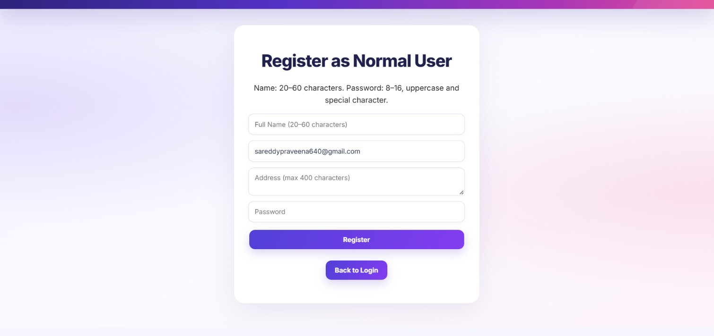
   
   
   
   
   
   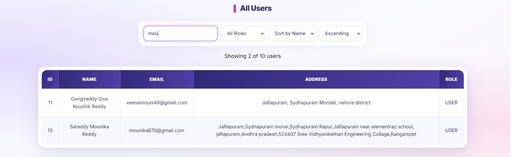
  

### 🏪 Store Owner

- Log in using store owner credentials.
- Access a dedicated store owner dashboard.
- View assigned stores.
- View average store ratings.
- View users who submitted ratings for their stores.
- View customer rating details.
- Log out of the application.
  ### 🏪 Store Owner
  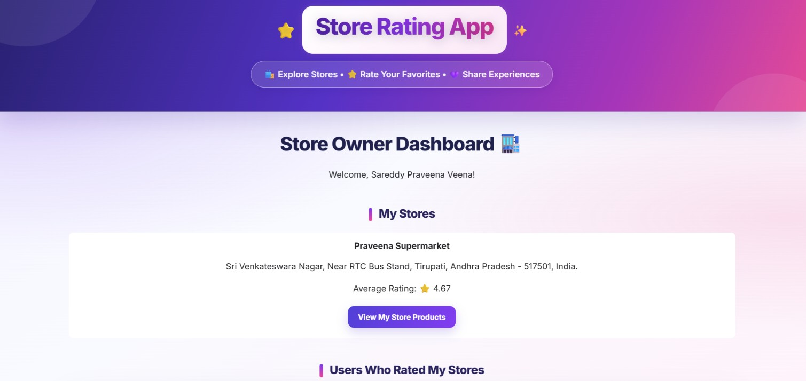
  
  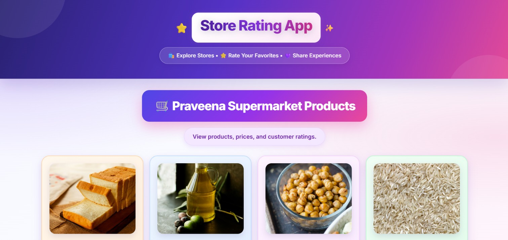
  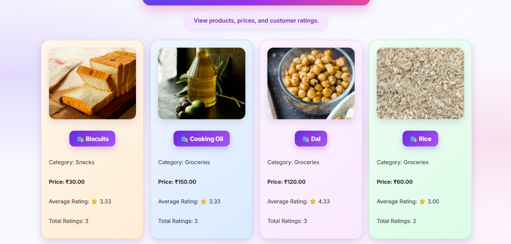
  
  

## 🔐 Form Validation Requirements

The coding challenge specifies the following validation rules:

| Field | Validation |
|---|---|
| Name | Minimum 20 and maximum 60 characters |
| Address | Maximum 400 characters |
| Password | 8–16 characters, at least one uppercase letter and one special character |
| Email | Must follow a valid email format |
| Rating | Must be between 1 and 5 |

## 📊 Dashboard Functionality

**Administrator Dashboard**
- Total Users
- Total Stores
- Total Ratings
- User and Store Details

**Normal User Dashboard**
- Available Stores
- Store Ratings
- Rating Submission and Updates

**Store Owner Dashboard**
- Store Details
- Average Store Rating
- Customers Who Rated the Store

## 📁 Project Structure

```text
StoreRatingApp/
│
├── backend/
│   ├── index.js
│   ├── hashPasswords.js
│   ├── package.json
│   └── package-lock.json
│
├── frontend/
│   ├── public/
│   ├── src/
│   │   ├── assets/
│   │   ├── App.jsx
│   │   ├── App.css
│   │   ├── index.css
│   │   └── main.jsx
│   ├── package.json
│   ├── package-lock.json
│   └── vite.config.js
│
├── .gitignore
└── README.md
```

## 🚀 Installation and Setup

### Prerequisites

- Node.js
- MySQL Server
- npm
- Git

### 1. Clone the Repository

```bash
git clone https://github.com/sareddypraveena/StoreRatingApp.git
cd StoreRatingApp
```

### 2. Backend Setup

```bash
cd backend
npm install
```

Create a `.env` file in the `backend` folder:

```env
DB_PASSWORD=your_mysql_password
JWT_SECRET=your_secure_random_secret
```

Configure the MySQL database named `store_rating` and create the required tables.

Start the backend:

```bash
node index.js
```

Backend URL:

`http://localhost:5000`

### 3. Frontend Setup

Open a new terminal:

```bash
cd frontend
npm install
npm run dev
```

Frontend URL (default):

`http://localhost:5173`

## 🗄️ Database

**Database Name:** `store_rating`

The application uses MySQL to manage:

- Users and their roles
- Registered stores
- Store ratings
- Relationships between users, stores, and submitted ratings

## 📋 Additional Challenge Requirements

The coding challenge also specifies:

- A single login system for all roles.
- Role-based access to functionality.
- Sorting support for relevant tables.
- Appropriate frontend and backend best practices.
- Proper database schema design.

## 📸 Application Screenshots

Screenshots can be added for:

- Home Page
- Login and Registration
- Administrator Dashboard
- Normal User Dashboard
- Store Owner Dashboard
- Store Listings and Ratings

## 🔮 Future Enhancements

- Advanced search and filtering
- Improved dashboard analytics
- Email notifications
- Cloud deployment
- Enhanced mobile responsiveness


## 📸 Application Screenshots

### 🏠 Home Page
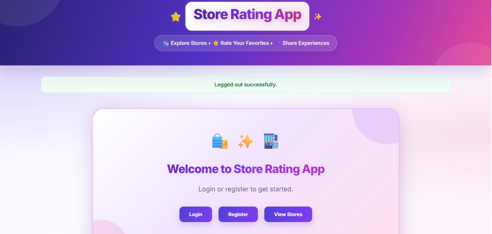
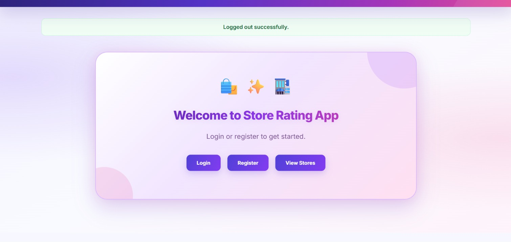

### 🔐 Login Page
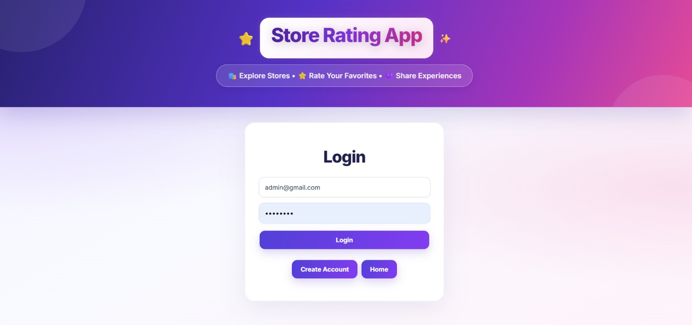

### 👨‍💼 Admin Dashboard


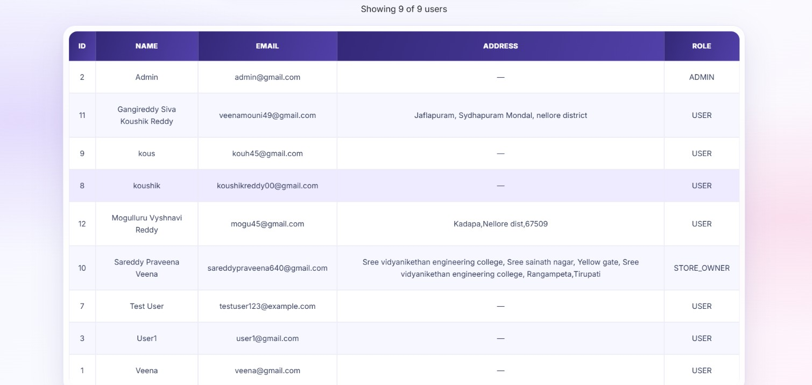

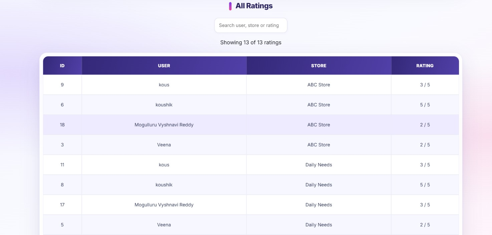
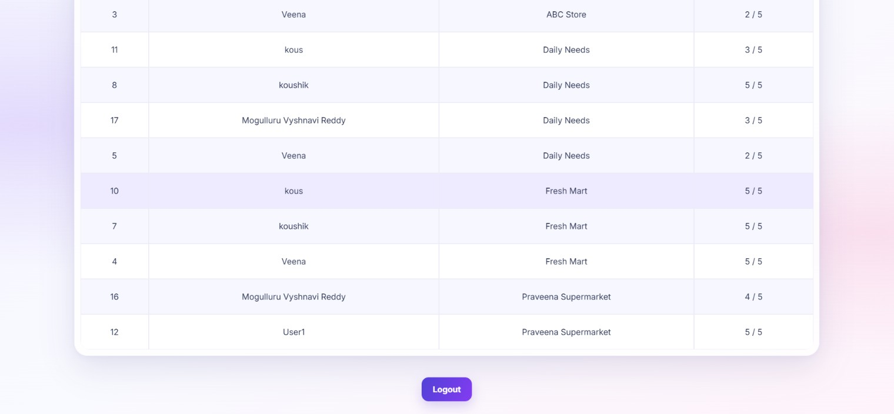


### 👤 User Dashboard


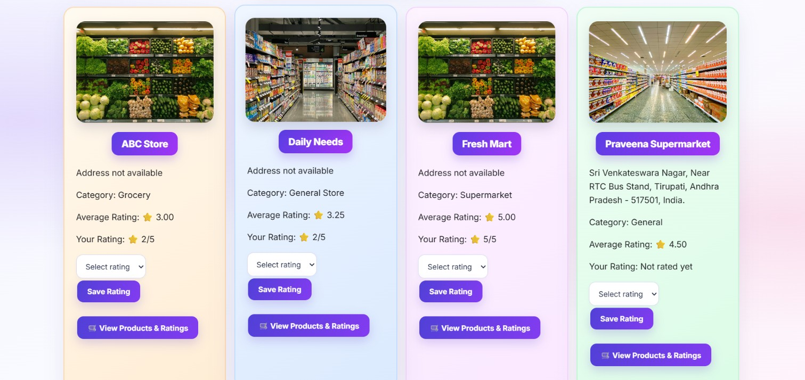
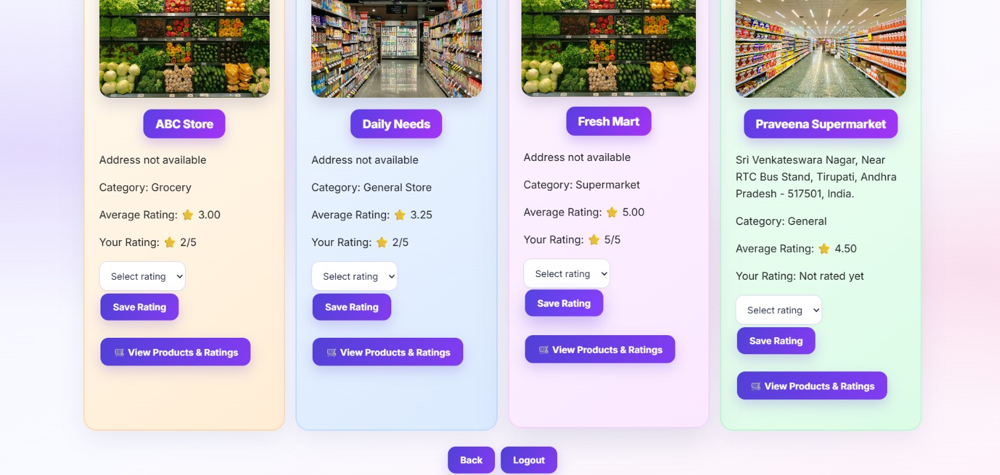


### ⭐ Store Ratings

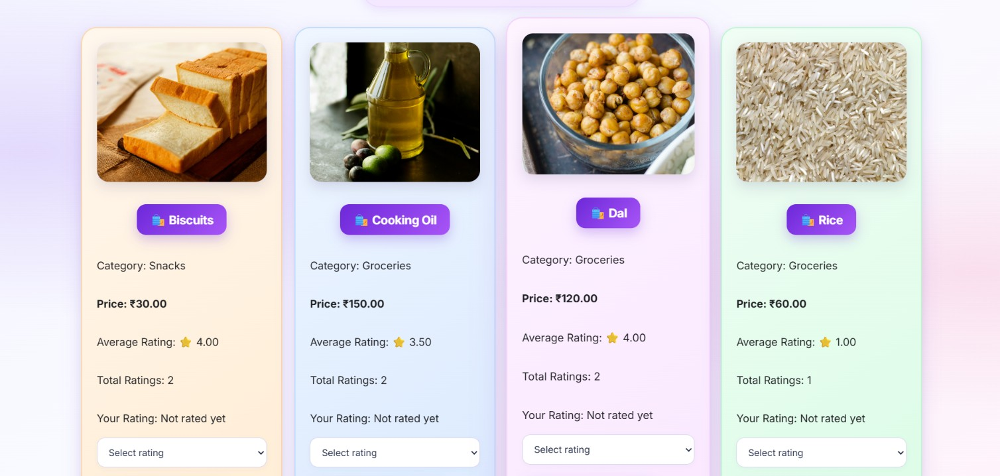
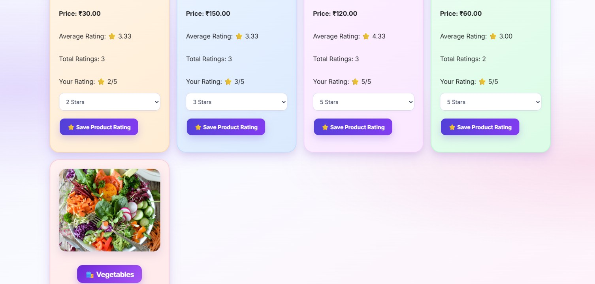


### 🖥️ Backend Output

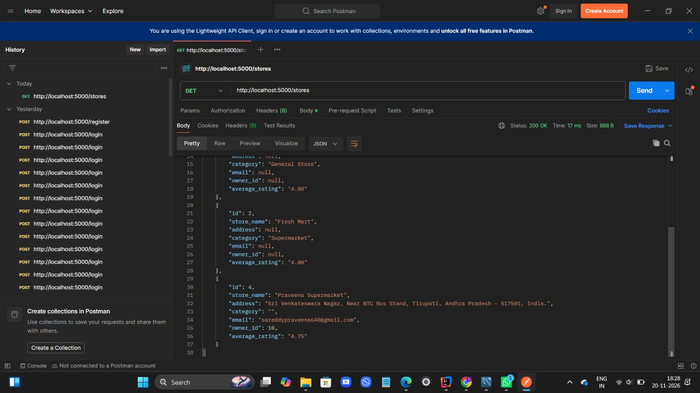

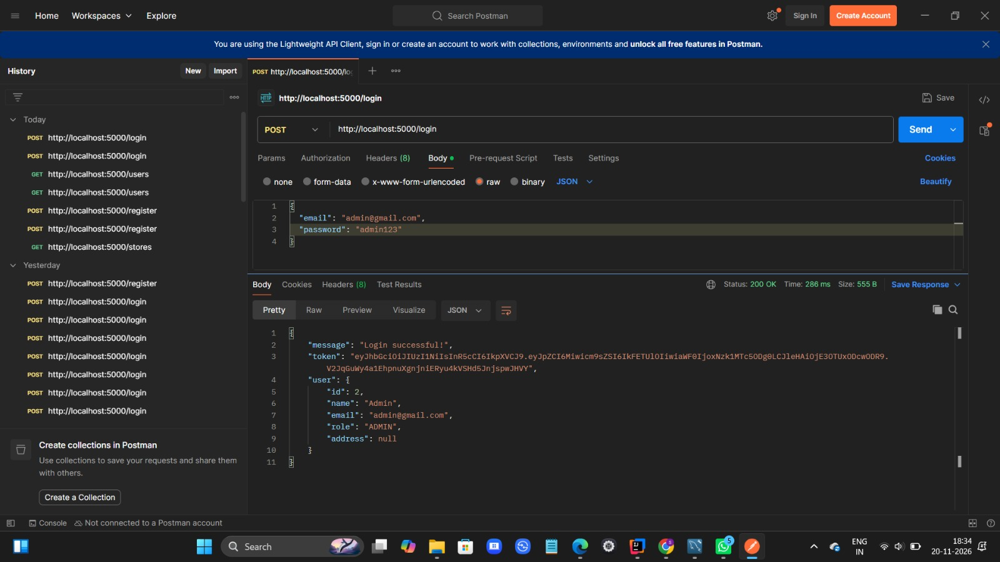
  

## 👩‍💻 Developed By

**Sareddy Praveena**

**GitHub:** [sareddypraveena](https://github.com/sareddypraveena)

**Project Repository:** [StoreRatingApp](https://github.com/sareddypraveena/StoreRatingApp)

---

⭐ **Explore Stores • Rate Your Favorites • Share Experiences**

*Developed as part of the FullStack Intern Coding Challenge.*
