### 🏪 A Full Stack Store Rating and Management System

A full-stack web application developed as part of the "FullStack Intern Coding Challenge". The platform allows users to explore registered stores, submit ratings from 1 to 5, and manage store information through role-based dashboards.

## 📖 Project Overview

The Store Rating App is designed to provide a centralized platform for store ratings and management.

The application supports three user roles:

1. System Administrator
2. Normal User
3. Store Owner

Each role has a dedicated dashboard and access to different functionalities.

## 🛠️ Tech Stack

| Component | Technology |
|---|---|
| Frontend | React.js, HTML, CSS, JavaScript |
| Backend | Node.js, Express.js |
| Database | MySQL |
| Authentication | bcryptjs, JWT |
| Development Tools | IntelliJ IDEA, VS Code |
| API Testing | Postman |
| Version Control | Git and GitHub |

## ✨ Features

### 🛡️ System Administrator

- Access an administrator dashboard.
- View the total number of registered users.
- View the total number of stores.
- View the total number of submitted ratings.
- View registered user information.
- View store information and ratings.
- Manage users and stores according to administrator permissions.
  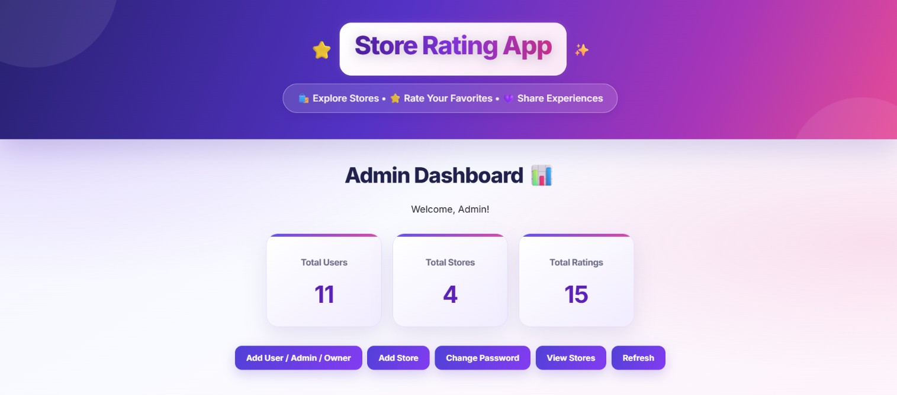


### 👤 Normal User

- Register using name, email, address, and password.
- Log in using registered credentials.
- View available stores.
- Search stores by name and address.
- View the overall rating of each store.
- Submit ratings from 1 to 5.
- Update previously submitted store ratings.
- Access a personalized user dashboard.
- Log out securely.
  ### 👤 Normal User
   
   
   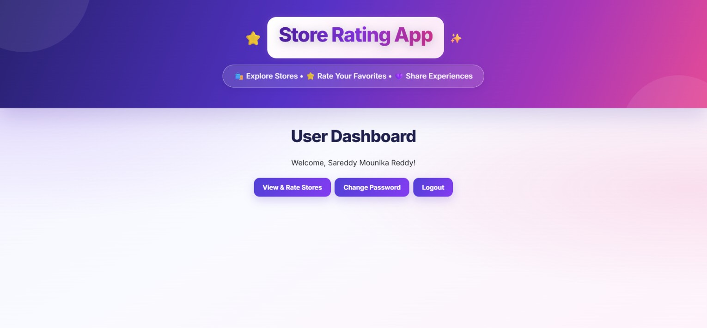
   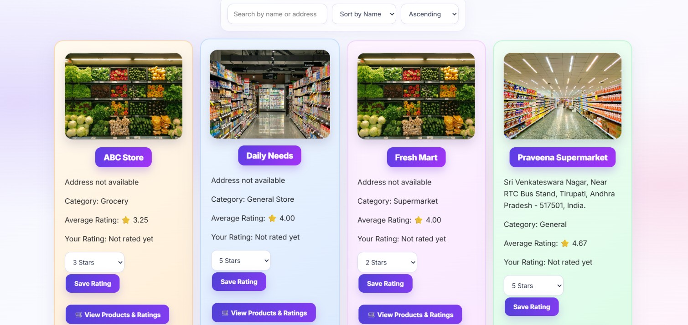
   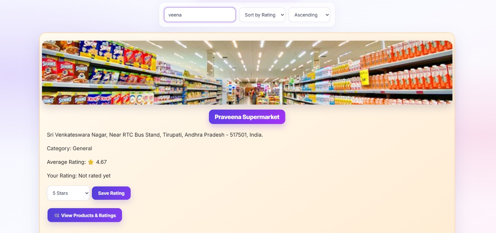
   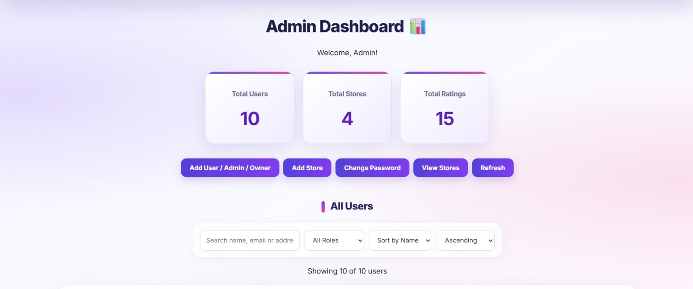
   
   
  

### 🏪 Store Owner

- Log in using store owner credentials.
- Access a dedicated store owner dashboard.
- View assigned stores.
- View average store ratings.
- View users who submitted ratings for their stores.
- View customer rating details.
- Log out of the application.
  ### 🏪 Store Owner
  
  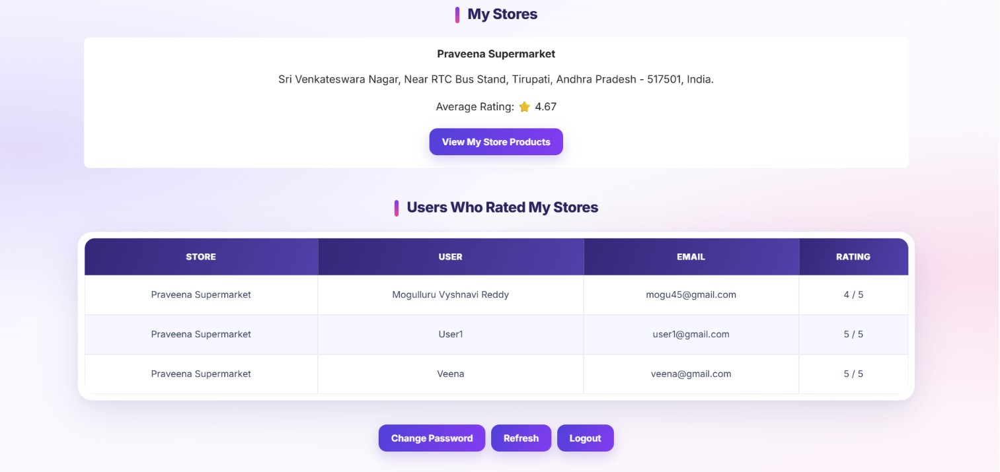
  
  
  
  

## 🔐 Form Validation Requirements

The coding challenge specifies the following validation rules:

| Field | Validation |
|---|---|
| Name | Minimum 20 and maximum 60 characters |
| Address | Maximum 400 characters |
| Password | 8–16 characters, at least one uppercase letter and one special character |
| Email | Must follow a valid email format |
| Rating | Must be between 1 and 5 |

## 📊 Dashboard Functionality

**Administrator Dashboard**
- Total Users
- Total Stores
- Total Ratings
- User and Store Details

**Normal User Dashboard**
- Available Stores
- Store Ratings
- Rating Submission and Updates

**Store Owner Dashboard**
- Store Details
- Average Store Rating
- Customers Who Rated the Store

## 📁 Project Structure

```text
StoreRatingApp/
│
├── backend/
│   ├── index.js
│   ├── hashPasswords.js
│   ├── package.json
│   └── package-lock.json
│
├── frontend/
│   ├── public/
│   ├── src/
│   │   ├── assets/
│   │   ├── App.jsx
│   │   ├── App.css
│   │   ├── index.css
│   │   └── main.jsx
│   ├── package.json
│   ├── package-lock.json
│   └── vite.config.js
│
├── .gitignore
└── README.md
```

## 🚀 Installation and Setup

### Prerequisites

- Node.js
- MySQL Server
- npm
- Git

### 1. Clone the Repository

```bash
git clone https://github.com/sareddypraveena/StoreRatingApp.git
cd StoreRatingApp
```

### 2. Backend Setup

```bash
cd backend
npm install
```

Create a `.env` file in the `backend` folder:

```env
DB_PASSWORD=your_mysql_password
JWT_SECRET=your_secure_random_secret
```

Configure the MySQL database named `store_rating` and create the required tables.

Start the backend:

```bash
node index.js
```

Backend URL:

`http://localhost:5000`

### 3. Frontend Setup

Open a new terminal:

```bash
cd frontend
npm install
npm run dev
```

Frontend URL (default):

`http://localhost:5173`

## 🗄️ Database

**Database Name:** `store_rating`

The application uses MySQL to manage:

- Users and their roles
- Registered stores
- Store ratings
- Relationships between users, stores, and submitted ratings

## 📋 Additional Challenge Requirements

The coding challenge also specifies:

- A single login system for all roles.
- Role-based access to functionality.
- Sorting support for relevant tables.
- Appropriate frontend and backend best practices.
- Proper database schema design.

## 📸 Application Screenshots

Screenshots can be added for:

- Home Page
- Login and Registration
- Administrator Dashboard
- Normal User Dashboard
- Store Owner Dashboard
- Store Listings and Ratings

## 🔮 Future Enhancements

- Advanced search and filtering
- Improved dashboard analytics
- Email notifications
- Cloud deployment
- Enhanced mobile responsiveness


## 📸 Application Screenshots

### 🏠 Home Page


### 🔐 Login Page


### 👨‍💼 Admin Dashboard
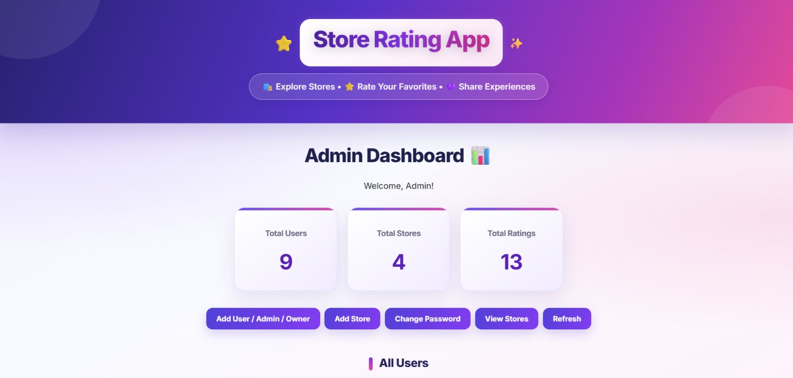
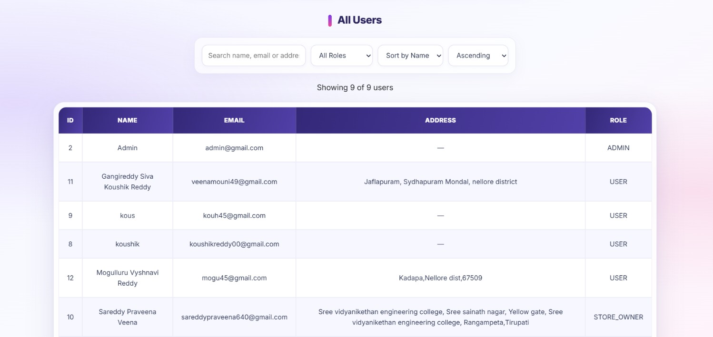

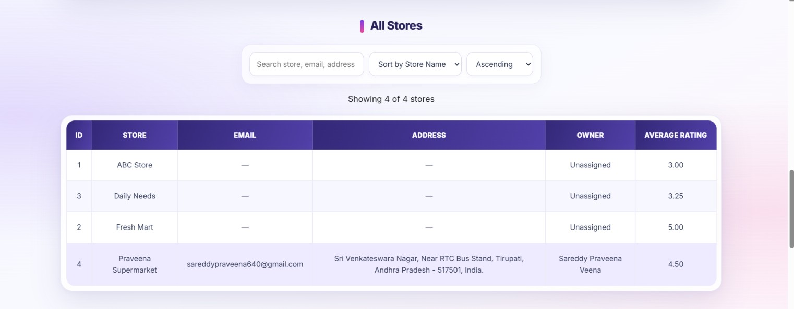


### 👤 User Dashboard
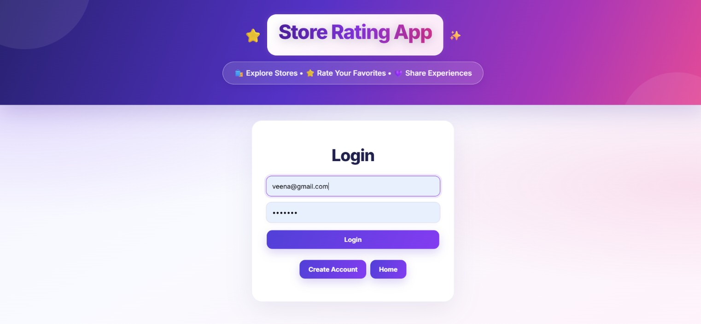

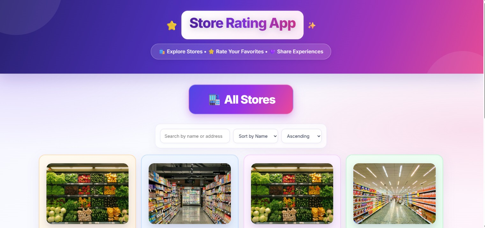


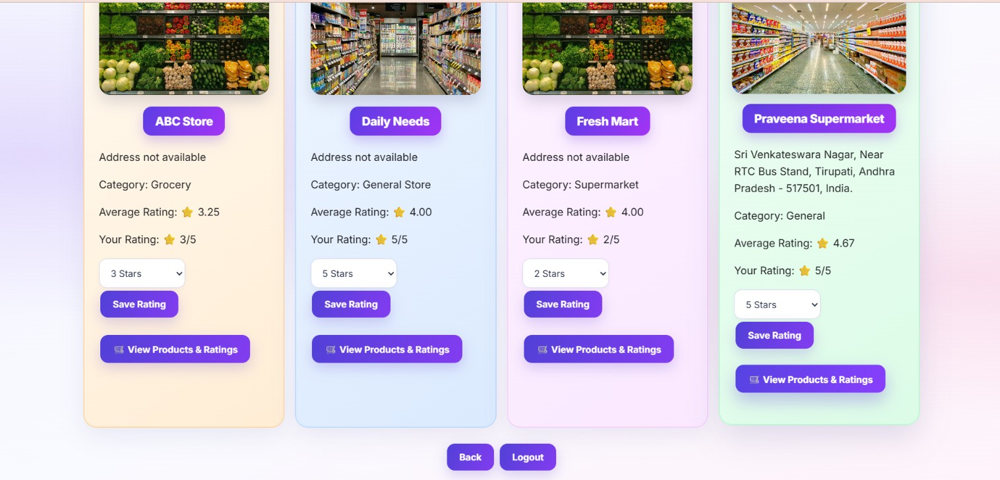
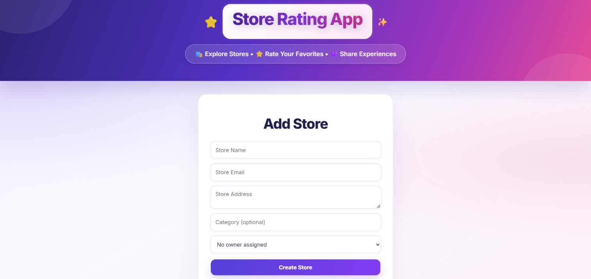


### ⭐ Store Ratings
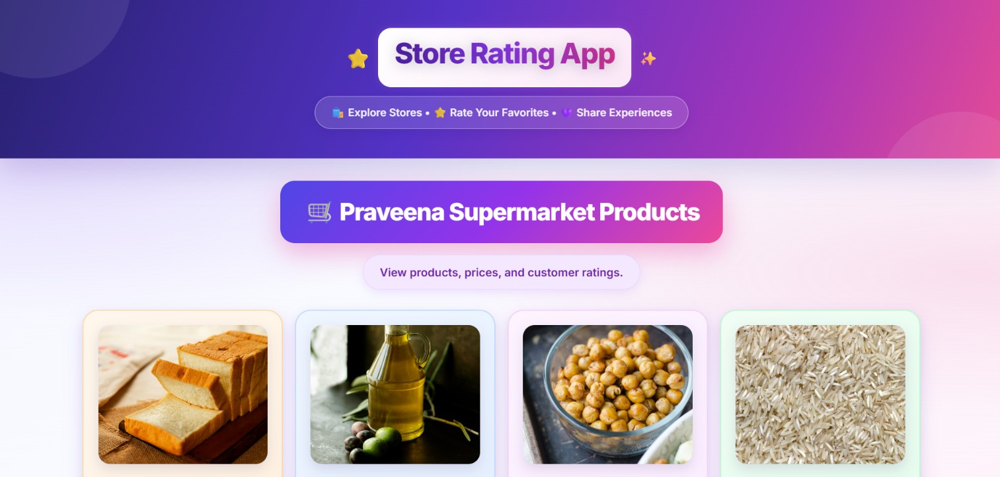


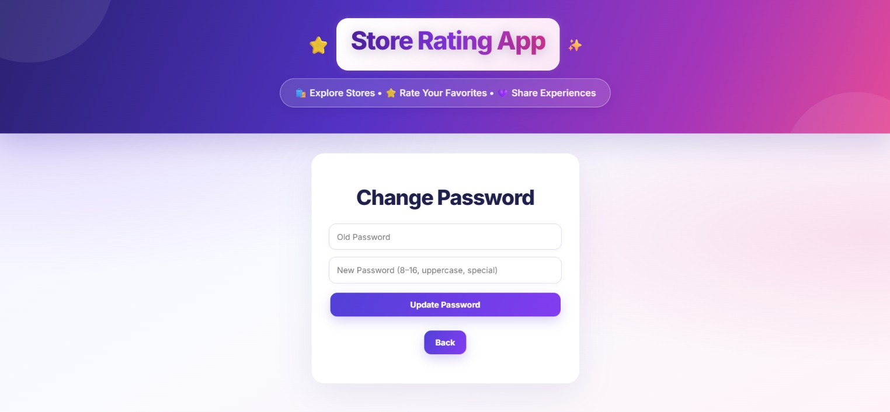


### 🖥️ Backend Output
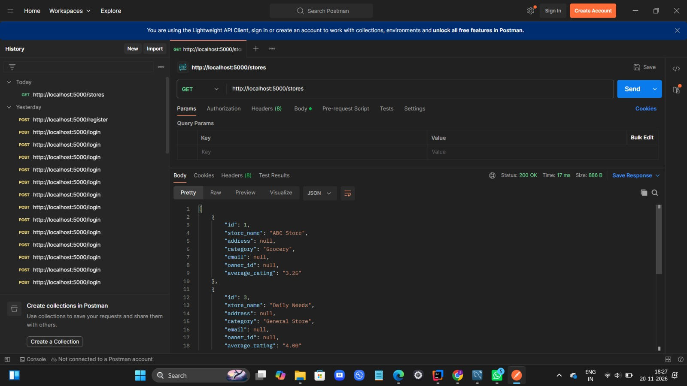

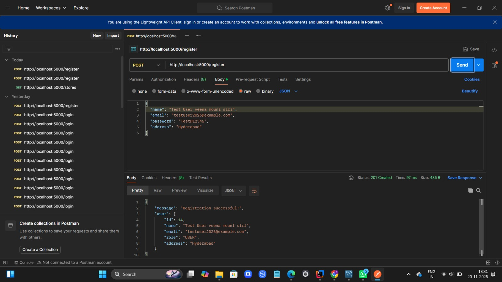


## 🗄️ Database Architecture & MySQL Outputs

The Store Rating App uses MySQL as its relational database to manage users, stores, and ratings.
The database is designed to maintain data integrity, manage relationships between tables, and prevent duplicate store ratings.
In database/schema.sql, create the store_rating database and these tables:
Table	What to include
users	id, name, email, password, address, role. Make email unique and store bcrypt password hashes.
stores	id, store_name, email, address, category, owner_id. Link owner_id to users.id.
ratings	id, user_id, store_id, rating. Add foreign keys to users and stores, enforce ratings from 1 to 5, and make (user_id, store_id) unique.
products and product_ratings	Include both if you keep the existing product-rating feature.

### 🏗️ 1. Database Schema Architecture (ER Diagram)

The Entity Relationship Diagram (ERD) illustrates the database structure and relationships between the `users`, `stores`, and `ratings` tables.

## [View Database Schema]

┌───────────────────┐   ┌───────────────────┐   ┌───────────────────┐
 │   ADMINISTRATOR   │   │    NORMAL USER    │   │    STORE OWNER    │
 │ Adds users/stores │   │ Searches stores   │   │ Views averages    │
 │ Views totals      │   │ Adds/edits ratings│   │ Sees who rated    │
 └─────────┬─────────┘   └─────────┬─────────┘   └─────────┬─────────┘
           │                       │                       │
           └───────────────────────┼───────────────────────┘
                                   ▼
 ┌───────────────────────────────────────────────────────────────────┐
 │                     FRONTEND · REACT + VITE                       │
 │                                                                   │
 │  Shared login page  ·  User signup  ·  Dashboards for each role  │
 └─────────────────────────────────┬─────────────────────────────────┘
                                   ↕
                   HTTP requests and JSON responses
                    Login token on protected requests
                                   ↕
 ┌───────────────────────────────────────────────────────────────────┐
 │                     BACKEND · NODE.JS + EXPRESS                   │
 │                                                                   │
 │  Checks passwords and roles                                       │
 │  Validates and saves ratings from 1 to 5                          │
 │  Retrieves dashboard totals, averages, and rater lists            │
 └─────────────────────────────────┬─────────────────────────────────┘
                                   ↕
                              SQL queries
                                   ↕
 ┌───────────────────────────────────────────────────────────────────┐
 │                          DATABASE · MYSQL                         │
 │                                                                   │
 │  Users               Stores                Ratings               │
 │  Account and role    Details and owner     User, store, score     │
 └───────────────────────────────────────────────────────────────────┘


### 📋 2. Database Tables Structure

The application uses three main tables:

| Table | Description |
|---|---|
| `users` | Stores registered users and their roles |
| `stores` | Stores information about registered stores |
| `ratings` | Stores user ratings for different stores |

### 👥 3. Users Table — MySQL Output

Displays the registered users stored in the database.

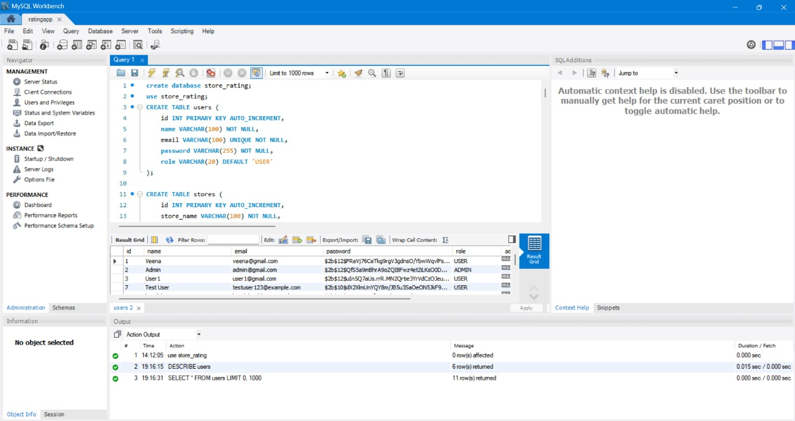
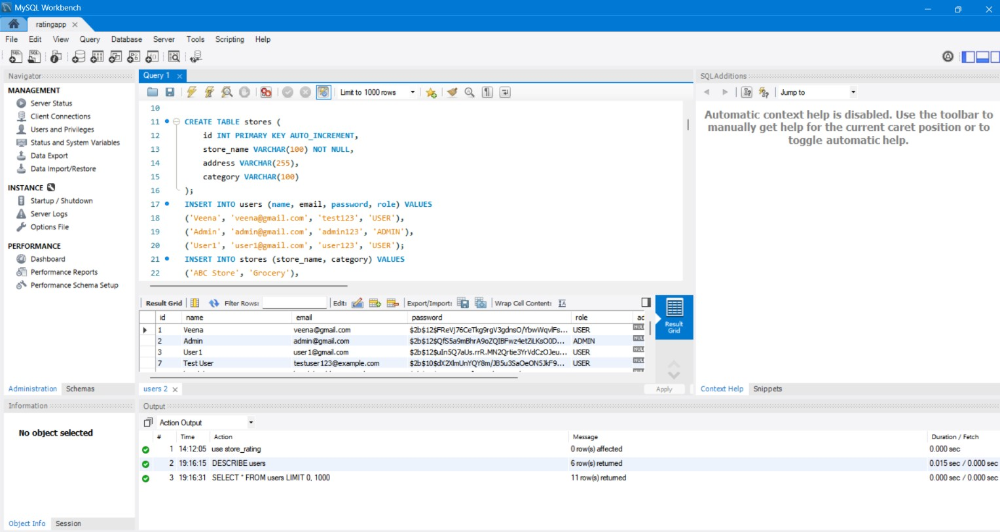
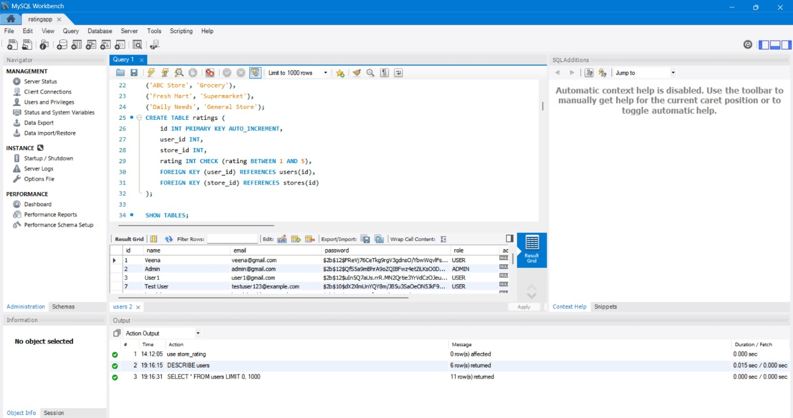
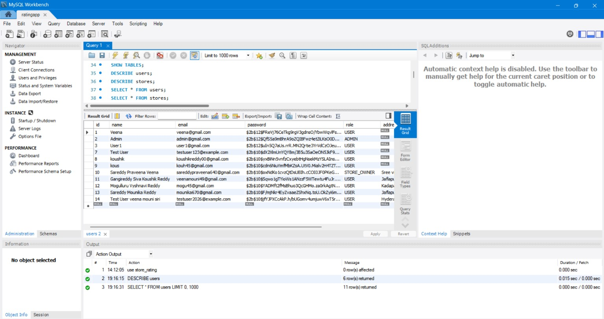

### 🏬 4. Stores Table — MySQL Output

Displays store details maintained in the database.

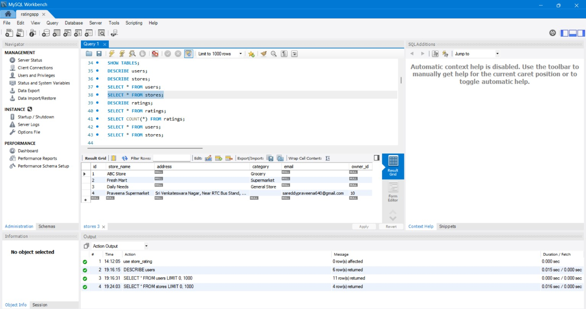

### ⭐ 5. Ratings Table — MySQL Output

Displays ratings submitted by users for different stores.


### 🔍 6. Database Query Results

MySQL queries used to verify the application data:

```sql
USE store_rating;

SELECT * FROM users;

SELECT * FROM stores;

SELECT * FROM ratings;
```

### 🔐 7. Database Integrity

- Primary keys uniquely identify records.
- Foreign keys define relationships between tables where configured.
- A unique constraint on `ratings(user_id, store_id)` prevents duplicate ratings for the same store by the same user.
- User passwords are stored as hashes rather than plain text.

### 📁 8. SQL Schema File

The SQL schema file contains the database table definitions and constraints required to recreate the database structure.

---
Database:MySQL  
Backend:Node.js + Express.js  
Frontend:** React.js  
Authentication: JWT


## 👩‍💻 Developed By

Sareddy Praveena

**GitHub: [sareddypraveena](https://github.com/sareddypraveena)

Project Repository: [StoreRatingApp](https://github.com/sareddypraveena/StoreRatingApp)

---

⭐ Explore Stores • Rate Your Favorites • Share Experiences

Developed as part of the FullStack Intern Coding Challenge.
